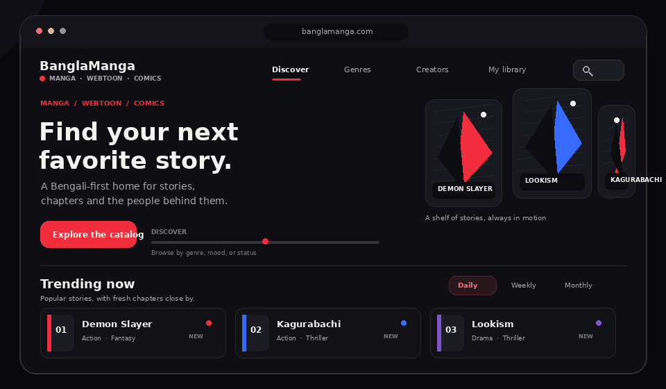

# BanglaManga

### Manga · Webtoon · Comics — stories to find, follow and keep close.

[Visit BanglaManga](https://www.banglamanga.com/) &nbsp; · &nbsp; [Browse genres](https://www.banglamanga.com/browse) &nbsp; · &nbsp; [Meet creators](https://www.banglamanga.com/creators)

*Custom-coded visual tour of the site's features, not a screenshot of its live interface.*

BanglaManga is a Bengali-first home for manga, webtoons and comics. Its website brings discovery, new chapters and a personal reading shelf together in one place.

## Find a story your way

The [browse catalogue](https://www.banglamanga.com/browse) lets readers explore by genre, choose one-shots or series, filter by series length and publication status, and sort by what is trending, recently updated, newly added, highly rated, highly hyped or longest-running. A mood matcher on the home page offers another route into the catalogue, with themed picks for action, sci-fi, mystery, romance and comedy.

## Keep up with the latest

The home page brings together daily, weekly and monthly trending lists with a stream of recent chapter updates. Series pages surface details such as genre, creator, status and available chapters, so it is easy to see what is new and where to continue.

## Make the library yours

Readers can bookmark stories and return to them from [My Library](https://www.banglamanga.com/library). Guest bookmarks stay in the current browser; signing in adds reading history and new-chapter markers, while the home page also offers reading progress and XP for signed-in readers.

## Meet the creators

The [creator directory](https://www.banglamanga.com/creators) gives each creator a profile and a place to explore their works.

---

**Ready for your next chapter?**  
[Explore BanglaManga](https://www.banglamanga.com/)

